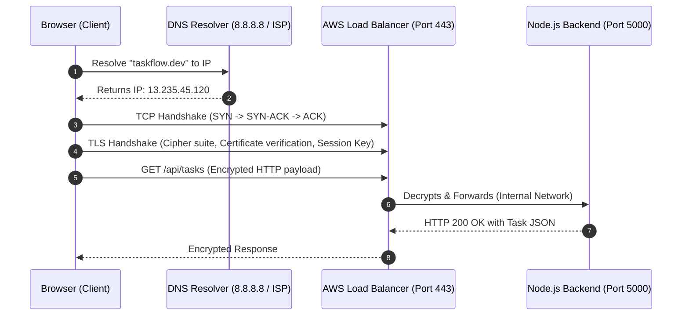

# HTTP, HTTPS, and DNS: The Anatomy of Web Communication

---

## 1. Definition
- **DNS (Domain Name System)**: The phonebook of the Internet. A decentralized global database that translates human-friendly domain names (e.g., `taskflow.dev`) into machine-routable IP addresses (e.g., `13.235.45.120`).
- **HTTP (Hypertext Transfer Protocol)**: An application-layer, text-based, stateless communication protocol that defines how messages are formatted and transmitted across the web.
- **HTTPS (HTTP Secure)**: HTTP encrypted with **TLS (Transport Layer Security)**, ensuring that all data in transit is encrypted, tamper-proof, and authenticated.

---

## 2. Problem: Why They Were Created
1. **The Human Memory Bottleneck**: Computers route packets using binary IP addresses (IPv4: `192.0.2.1`, IPv6: `2001:db8::1`). Humans cannot remember numeric addresses for hundreds of web services. DNS was created to decouple human names from machine locations.
2. **Eavesdropping and Man-In-The-Middle (MITM) Attacks**: Standard HTTP sends headers, cookies, passwords, and JSON payloads in plain text. Any network router, ISP, or rogue Wi-Fi hotspot between the user and server could read or modify the data. HTTPS was introduced to encrypt the connection end-to-end.

---

## 3. Internal Working: From URL to Pixel

What happens when you type `https://taskflow.dev/api/tasks` in your browser?



### The TLS Handshake (Under the Hood):
1. **Client Hello**: Browser sends supported TLS versions and cryptographic cipher suites.
2. **Server Hello & Certificate**: Server responds with its chosen cipher suite and sends its **SSL/TLS Certificate** containing its **Public Key** (signed by a trusted Certificate Authority like Let's Encrypt or DigiCert).
3. **Key Exchange**: The browser verifies the certificate against built-in operating system trust stores, generates a random symmetric session key, encrypts it with the server's public key, and sends it to the server.
4. **Symmetric Encryption**: Both parties now share a secret session key. All further HTTP traffic is encrypted using high-speed symmetric algorithms (e.g., AES-GCM or ChaCha20).

---

## 4. Architecture: DNS Hierarchy

```
                      Root DNS Servers (.)
                               │
                      TLD DNS Servers (.dev, .com)
                               │
               Authoritative Name Servers (Route 53, Cloudflare)
                               │
                   IP Address: 13.235.45.120
```

- **A Record**: Maps a domain name directly to an IPv4 address (`taskflow.dev` → `13.235.45.120`).
- **AAAA Record**: Maps a domain name to an IPv6 address.
- **CNAME (Canonical Name)**: Maps an alias domain to another domain name (`www.taskflow.dev` → `taskflow.dev`).
- **TTL (Time to Live)**: The number of seconds intermediate DNS caches (browsers, ISPs, routers) are allowed to remember the IP before asking the authoritative server again.

---

## 5. Practical: Commands & Diagnostics

Run these in PowerShell to debug DNS and HTTP connections:

```powershell
# 1. Query DNS records and check TTL directly using Resolve-DnsName
Resolve-DnsName -Name google.com -Type A

# 2. Trace the exact path and latency of DNS queries
nslookup taskflow.dev 8.8.8.8

# 3. Test HTTP status, headers, and SSL certificates via curl
curl.exe -I https://httpbin.org/get

# 4. Measure connection timings (DNS lookup time, TCP connect time, TLS handshake)
curl.exe -w "DNS: %{time_namelookup}s | Connect: %{time_connect}s | TLS: %{time_appconnect}s | Total: %{time_total}s\n" -o $null -s https://google.com
```

---

## 6. Project Usage in TaskFlow
- In **local development**: We access our app via `http://localhost:3000` (frontend) and `http://localhost:5000` (backend) without TLS encryption to speed up iteration.
- In **production on AWS**:
  1. We register our domain in **AWS Route 53** (or Cloudflare).
  2. Route 53 creates an **A Record (Alias)** pointing traffic to an **AWS Application Load Balancer (ALB)**.
  3. The Load Balancer terminates HTTPS using a free **AWS ACM (Certificate Manager)** or Let's Encrypt certificate on port `443`.
  4. The Load Balancer proxies plain HTTP requests across private subnets to our Node.js Docker containers on port `5000`.

---

## 7. Real-World Context: TLS Termination & Reverse Proxies
In modern cloud architectures, you almost **never** configure SSL certificates inside your Node.js or React container code.
Instead, companies use **TLS Termination at the Edge**:
- A reverse proxy (Cloudflare, AWS ALB, Nginx) terminates the encrypted HTTPS connection at the edge.
- Unencrypted HTTP is passed across isolated, private VPC subnets to the container.
- *Why?* Cryptographic operations consume CPU cycles. Offloading TLS to specialized hardware/load balancers keeps application containers lean and fast.

---

## 8. Troubleshooting: Common Errors & Solutions
| Problem | Cause | Solution |
|---|---|---|
| `ERR_NAME_NOT_RESOLVED` | DNS cannot find an A/CNAME record for the domain. | Check domain registrar settings, nameserver delegations, and TTL expiration. |
| `SSL Certificate Expired / Untrusted` | The certificate has passed its validity window, or was signed by an unknown self-signed CA. | Automated renewal using Let's Encrypt Certbot cron jobs or AWS ACM automated rotation. |
| `Mixed Content Warning` | The website was served over `https://`, but loaded images or APIs over `http://`. | Ensure all API URLs and static assets use relative paths or HTTPS schemes. |

---

## 9. Interview Preparation
1. **Q: What is the difference between an A record and a CNAME record?**
   - *Answer*: An `A record` directly maps a hostname to an IP address (e.g., `api.example.com` → `192.0.2.1`). A `CNAME record` maps an alias hostname to another hostname (e.g., `www.example.com` → `example.com`). Root domains (`example.com`) cannot typically be CNAMEs according to RFC standards, which is why cloud providers created ALIAS/ANAME records.
2. **Q: What is the difference between HTTP/1.1, HTTP/2, and HTTP/3?**
   - *Answer*: HTTP/1.1 suffered from head-of-line blocking (one request per TCP connection at a time). HTTP/2 introduced binary framing and multiplexing over a single TCP connection. HTTP/3 replaced TCP with **QUIC (UDP-based)**, eliminating packet-loss blocking at the transport layer.

---

## 10. Revision & Key Takeaways
- DNS translates names to numbers; TTL dictates how long records are cached.
- HTTPS adds encryption, authentication, and integrity over HTTP via TLS handshakes.
- In production, we terminate TLS at the Load Balancer or Nginx, keeping backend container code simple and focused on business logic.
