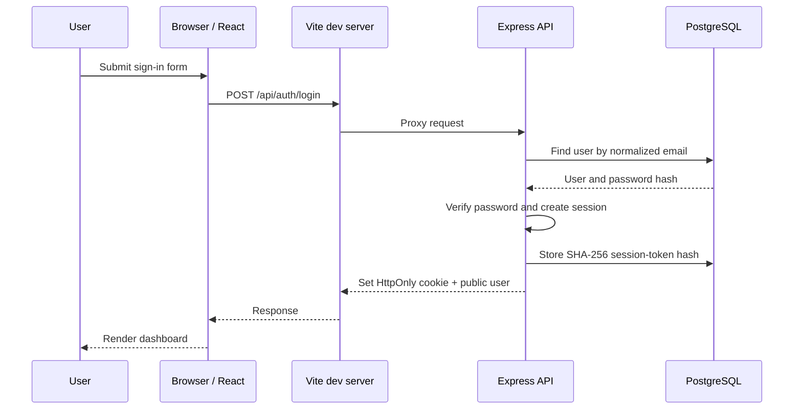

# TaskFlow Application Architecture

## 1. The system at a glance

TaskFlow uses a three-tier application structure:

| Tier | Component | Responsibility |
|---|---|---|
| Presentation | React + TypeScript | Render the UI and collect user actions |
| Application | Node.js + Express | Authenticate, validate, authorize, and apply business rules |
| Data | PostgreSQL | Persist users, sessions, and tasks |

The tiers are separate logical responsibilities. In local development, all three can run on one laptop.

## 2. Local request flow

The Vite server serves the frontend on `127.0.0.1:5173`. It proxies `/api` and `/health` to Express on `127.0.0.1:5000`. Express communicates with PostgreSQL on `127.0.0.1:5432`.

For a task request, the API reads the cookie, hashes the opaque token, checks the session, then performs the task query with both task ID and authenticated user ID where applicable.

## 3. Frontend responsibilities

The frontend:
- Displays registration and login forms.
- Loads the current user when the page opens.
- Sends API requests with browser credentials enabled.
- Displays task statistics and status filters.
- Provides create and edit forms.
- Does basic browser-side feedback, while relying on the backend for authoritative validation.

The browser is untrusted. Hiding a button or validating a form in React is not a security boundary.

## 4. Backend responsibilities

The backend:
- Parses JSON with a request-body size limit.
- Validates input using Zod.
- Hashes passwords with bcryptjs.
- Issues opaque random session tokens and stores only SHA-256 hashes of those tokens.
- Loads the authenticated user through middleware.
- Requires authentication for task routes.
- Scopes task reads, updates, and deletes to the authenticated user.
- Uses parameterized SQL values.
- Returns structured HTTP status codes and safe error messages.

The frontend does not receive password hashes or raw session tokens in JSON. The session token is sent as an HttpOnly cookie.

## 5. Database responsibilities

PostgreSQL stores:
- Users and password hashes.
- Session-token hashes and expiry timestamps.
- Tasks with ownership, status, priority, and optional due date.

Foreign keys enforce relationships. Check constraints limit valid status and priority values. Indexes support user-scoped task reads and session lookups.

## 6. Why use a connection pool?

Opening a brand-new database connection for every request creates unnecessary connection setup overhead and can exhaust database connection limits. The `pg.Pool` object reuses a bounded number of connections. The initial pool limit is 10; it will need to be reconsidered when the number of API instances and database capacity increase.

## 7. Development proxy and same-origin browser requests

The browser talks to the Vite origin. Vite forwards API traffic to the Express process. This avoids needing the browser to call a separate port directly in development and allows the cookie to stay associated with the development origin.

The API still has an explicit allowed frontend origin for deployments where the frontend and API are hosted on different origins.

## 8. Future deployment mapping

This is a future conceptual mapping, not an implementation in Phase 1:

| Local component | Later infrastructure concept |
|---|---|
| Vite-built static frontend | Static hosting or web server |
| Express process | Container on a compute service |
| PostgreSQL local service | Managed PostgreSQL such as RDS |
| npm build | CI build stage |
| Manual app start | Deployment process managed by infrastructure |

Docker, AWS, and CI/CD are intentionally deferred to their own phases.
