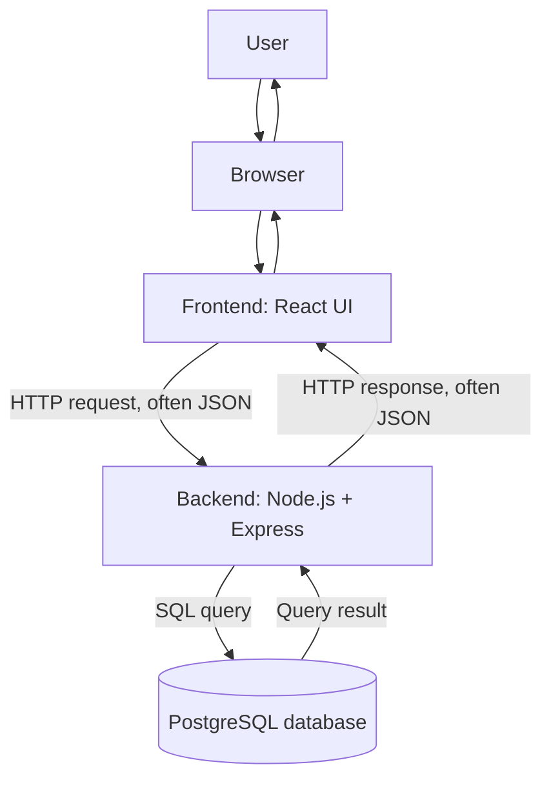

# TaskFlow — Proposed Application Architecture

**Status:** Learning design only. This architecture is not implemented or deployed.

## 1. What does full-stack mean?

A web application normally has several cooperating parts:

- **Frontend:** the part the user sees and interacts with.
- **Backend:** the server-side application that applies rules, checks identity and permissions, and coordinates data.
- **Database:** the system that stores information so it remains available after a process or browser closes.
- **API:** the agreed interface through which software components communicate.

Together these parts form the application's stack. Full-stack understanding means knowing how the parts work individually and how information moves between them.

## 2. Proposed technology mapping

| Responsibility | Proposed technology | Important distinction |
|---|---|---|
| User interface | Browser + React | React is a UI library; the browser is the execution environment for the page |
| Language and type checking | JavaScript + TypeScript | TypeScript adds a static type system and is transformed before browser execution |
| Server-side JavaScript runtime | Node.js | Node.js runs JavaScript outside the browser |
| HTTP server framework | Express | Express provides routing and middleware on top of Node.js |
| Persistent relational data | PostgreSQL | The database is a separate service, not a part of React or Express |
| Data exchange | HTTP + JSON | HTTP is the protocol; JSON is one common message format |

A framework or library does not replace the runtime. For example, Express runs on Node.js; React code normally runs in the browser.

## 3. High-level request flow

The frontend does not connect directly to PostgreSQL. The backend mediates access, checks the request, applies business rules, and decides what data may be returned.

## 4. Example: a user creates a task

1. The user enters a task title and selects Save in the browser.
2. The frontend reads the form values and sends an HTTP request to the backend API.
3. The backend receives the request and parses the incoming data.
4. The backend validates the values. It also identifies the signed-in user and checks permission to create the task.
5. The backend sends a parameterized SQL command to PostgreSQL.
6. PostgreSQL stores the row and returns the result.
7. The backend creates an HTTP response, commonly containing JSON.
8. The frontend reads the response and updates the visible task list.

This sequence separates presentation from authoritative business rules and persistent storage.

## 5. Which part is responsible for what?

### Browser and frontend

- Render the user interface.
- Collect input and provide interaction.
- Display loading, success, and error states.
- Send requests to backend endpoints.
- Improve usability with immediate feedback.

The browser is under the user's control. A person can modify browser code, send requests manually, or bypass a hidden button. Frontend checks are useful for user experience, not as the final security boundary.

### Backend

- Receive and route requests.
- Validate untrusted input.
- Authenticate the caller.
- Authorize actions on specific resources.
- Apply business rules.
- Communicate with databases and other services.
- Return controlled responses and handle errors.

### Database

- Persist application data.
- Enforce relationships and constraints.
- Execute queries and transactions.
- Provide a durable source of truth for stored records.

## 6. A few terms that are easy to confuse

| Term | Meaning |
|---|---|
| Runtime | The environment that executes a program, such as Node.js |
| Language | The notation used to write a program, such as JavaScript or TypeScript |
| Framework | A structure and set of conventions that helps build an application, such as Express |
| Library | Reusable code that an application calls, such as React |
| API | A defined interface that software uses to communicate |
| Protocol | Rules for communication, such as HTTP |
| Database | A system that stores and retrieves structured data |
| Hosting | Where an application or service runs and is made available |

## 7. Development architecture versus production architecture

During local development, a frontend development server, backend process, and database may all run on one laptop. In production, the frontend might be served from a static hosting platform, the backend might run on a cloud compute service, and PostgreSQL might run as a managed database.

Those are deployment choices. They do not change the logical responsibilities of frontend, backend, API, and database.

We will study Docker, cloud hosting, DNS, reverse proxies, HTTPS, and CI/CD in their own later phases rather than mixing them into this first application lesson.

## 8. Questions to be able to answer

- Why should the browser not connect directly to the production database?
- Why is frontend validation not enough for security?
- What does the API do between the frontend and backend?
- Why are Node.js and Express not the same thing?
- What happens after PostgreSQL returns a query result?
- Which responsibilities remain the same when the app moves from a laptop to cloud hosting?
