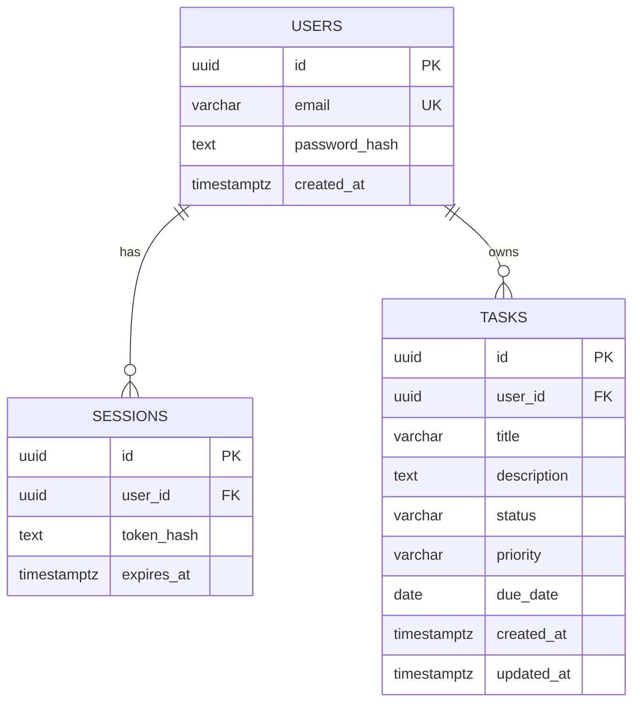

# TaskFlow — Proposed Database Design

**Status:** Conceptual schema for learning relational database design. No database has been created and no migration has been run.

## 1. What is a relational database?

A relational database stores structured information in tables. A table contains columns and rows:
- A **column** describes a kind of value, such as a task title.
- A **row** is one record.
- A **primary key** uniquely identifies a row.
- A **foreign key** links a row to a row in another table.
- A **constraint** restricts which values or relationships are allowed.
- An **index** helps the database find rows more efficiently for certain query patterns.

PostgreSQL is the proposed relational database for TaskFlow. SQL is the language used to define, query, and change relational data.

## 2. Proposed entities and relationships

For a simple task-management system, three useful entities are users, sessions, and tasks.



This is a teaching model. The final schema may change after requirements and security decisions are reviewed.

## 3. Why separate the tables?

### users

Stores account information. A unique constraint on normalized email can prevent duplicate accounts. The table should contain a password hash, not a plaintext password.

### sessions

Represents active login sessions when using a server-side session design. Each session belongs to one user and has a validity period. A session should be revocable.

### tasks

Stores work items. Each task has an owner, so the database model can represent which user owns which task.

## 4. Relationships and constraints

A foreign key from `tasks.user_id` to `users.id` expresses that each task belongs to a valid user. A foreign key from `sessions.user_id` to `users.id` does the same for sessions.

Constraints can enforce valid values, such as:
- A task title cannot be blank.
- A task status must be one of the allowed values.
- A task priority must be one of the allowed values.
- An email must be unique.

These checks protect data even when a request does not come from the intended frontend.

## 5. Example SQL concepts

A query to read tasks might look like:

```sql
SELECT id, title, status
FROM tasks
WHERE user_id = $1
ORDER BY created_at DESC;
```

The `$1` is a parameter placeholder. The actual value is supplied separately by the database client. This is safer than concatenating untrusted text into SQL.

A primary key and foreign key are defined in schema statements, often using `CREATE TABLE`. We will study the SQL syntax and migration process before running any commands.

## 6. Why ownership belongs in the data query

A task query should be scoped to the authenticated user's ID, not only to a task ID supplied by the browser. That way, even if a user guesses another task's identifier, the database operation still checks ownership.

This is an example of enforcing an authorization rule at the backend/data boundary rather than trusting the UI.

## 7. Indexes and performance

An index is an additional data structure that can make selected lookups faster. Indexes also consume storage and add work when rows are inserted, updated, or deleted. They should support real query patterns rather than being added indiscriminately.

We will return to query plans, transactions, connection pooling, backups, replication, and managed databases in the later scaling and cloud phases.

## 8. Questions to review

- What is the difference between a row and a column?
- What does a primary key guarantee?
- Why would a task table need a foreign key to users?
- What problem does a unique constraint solve?
- Why are SQL parameters safer than string concatenation?
- How can an index help, and what does it cost?
