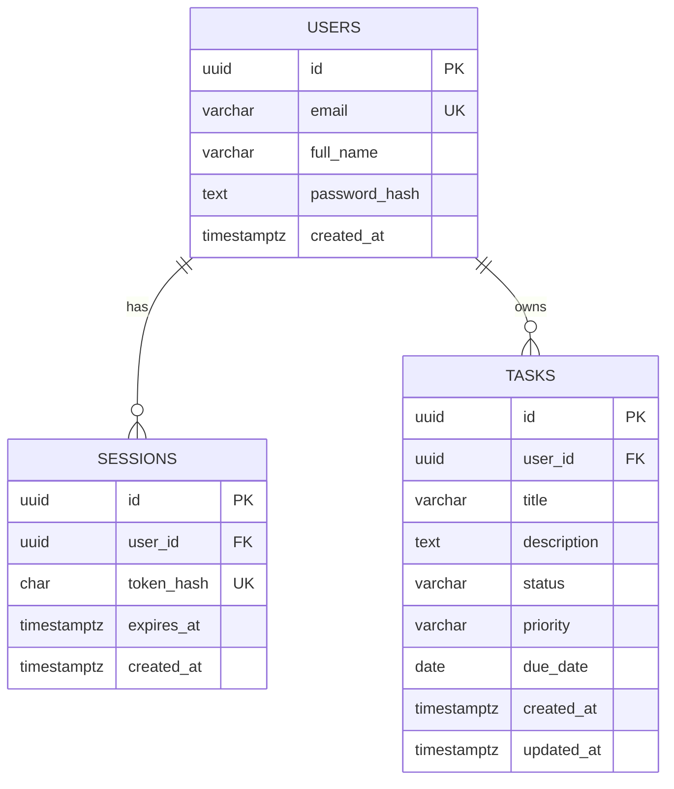

# TaskFlow Database Design

## 1. Database choice

TaskFlow uses PostgreSQL, a relational database. Relational databases organize data into tables and use keys and constraints to protect relationships and valid values.

We use PostgreSQL directly in Phase 1 so database concepts are visible without Docker abstractions. Docker will be introduced separately.

## 2. Entity relationship diagram



## 3. Table responsibilities

### users

Stores one row per registered account.
- `id`: UUID generated by the application.
- `email`: unique, normalized to lowercase by backend validation.
- `full_name`: optional display name.
- `password_hash`: bcrypt hash. Never store plaintext passwords.

### sessions

Stores opaque login sessions.
- The browser receives a cryptographically random session token in an HttpOnly cookie.
- The database stores only the SHA-256 hash of that token.
- Expired sessions are rejected.
- Sessions are deleted on logout and expired sessions are periodically cleaned when a new session is created.

A SHA-256 hash is appropriate for a high-entropy random session token. Passwords are different: they are human-chosen and require a deliberately slow password-hashing function such as bcrypt.

### tasks

Stores tasks owned by a user.
- `user_id` links each task to its owner.
- `status` is one of `todo`, `in_progress`, or `completed`.
- `priority` is one of `low`, `medium`, or `high`.
- `due_date` is a calendar date, not a timestamp.
- `updated_at` changes on task update.

## 4. Constraints and indexes

The migration creates:
- Primary keys for each table.
- Unique constraint on user email.
- Foreign keys from sessions and tasks to users with `ON DELETE CASCADE`.
- Check constraints for lowercase email, non-blank task title, valid status, and valid priority.
- Indexes for user session lookups, session expiry, and user task queries.

Indexes can speed up reads but consume disk and add work to inserts/updates. Add indexes to support measured query patterns, not automatically for every column.

## 5. Ownership is enforced in the query

Task updates and deletes include both the task ID and the authenticated user ID:

```sql
UPDATE tasks
SET title = $1, updated_at = NOW()
WHERE id = $2 AND user_id = $3;
```

That is important. Hiding another user's task in the UI is not sufficient. The database operation itself must be scoped to the authenticated owner.

## 6. Parameterized queries

Values are passed separately from SQL text:

```ts
await pool.query(
  "SELECT id, title FROM tasks WHERE user_id = $1",
  [authenticatedUserId]
);
```

Do not build SQL by concatenating untrusted values into a query string. The task update route constructs column assignments only from a fixed allowlist and passes all values as parameters.

## 7. Migration strategy

The schema is versioned in `backend/migrations/`. The migration runner:
1. Creates a `schema_migrations` table if it does not exist.
2. Reads SQL migration files in filename order.
3. Skips migrations already recorded.
4. Runs each unapplied migration in a transaction.
5. Records the filename only after the SQL succeeds.

Never edit an already-applied migration in a shared or deployed environment. Add a new migration for later schema changes.

## 8. Future database topics

We will revisit connection limits, backup/restore, transaction isolation, query plans, indexes, pooling, replication, and managed PostgreSQL when we reach scaling and AWS phases.
