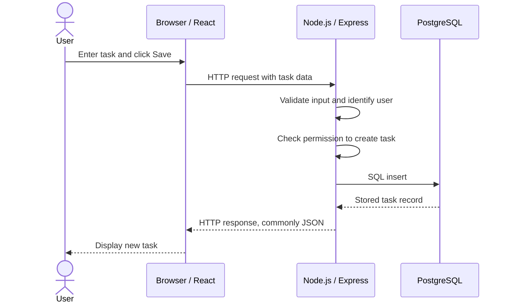

# Lesson 1.1 — Full-Stack Architecture and the Request Lifecycle

**Phase:** 1 — Full-stack application fundamentals  
**Lesson:** 1 of 6  
**Status:** Study material published; learner checkpoint pending  
**Purpose:** Understand how the main parts of a modern web application work together before implementing TaskFlow.

## 1. Learning outcomes

After this lesson, you should be able to:

- Explain what frontend, backend, database, API, client, and server mean.
- Describe the purpose of a three-tier application architecture.
- Explain where React, TypeScript, Node.js, Express, PostgreSQL, HTTP, and JSON fit.
- Trace a request from a user's browser through the backend to the database and back.
- Explain why the browser should not connect directly to the application's database.
- Distinguish application architecture from deployment architecture.

This is project-level understanding. Browser-engine internals, framework internals, and advanced distributed-systems theory are outside this lesson.

## 2. What does full-stack mean?

A modern web application commonly has three major parts:

1. **Frontend:** what the user sees and interacts with.
2. **Backend:** the server-side application that processes requests and enforces business rules.
3. **Database:** where application information is stored and retrieved.

For example, when a user signs in to a banking application, the browser displays the login form, the backend verifies the submitted credentials, and the database provides the account records needed by the application.

The user sees one application, but several components cooperate behind the scenes.

**Key idea:** an application is not necessarily one program. It is a collection of cooperating components with different responsibilities.

## 3. The three-tier architecture

TaskFlow's proposed architecture follows the common three-tier model:

| Tier | Common name | TaskFlow responsibility |
|---|---|---|
| Presentation tier | Frontend | Display pages, forms, task cards, and user interactions |
| Application tier | Backend | Process requests, validate input, enforce permissions, and apply business rules |
| Data tier | Database | Persist users, sessions, tasks, and related records |

```text
+---------------------------------------+
| PRESENTATION TIER                     |
| Browser + React + TypeScript          |
| Screens, forms, task list, interaction|
+---------------------------------------+
                   |
          HTTP request / response
             (often JSON)
                   |
                   v
+---------------------------------------+
| APPLICATION TIER                      |
| Node.js + Express                     |
| Routes, validation, authentication,   |
| authorization, and business logic    |
+---------------------------------------+
                   |
              SQL queries
                   |
                   v
+---------------------------------------+
| DATA TIER                              |
| PostgreSQL                            |
| Persistent relational application data|
+---------------------------------------+
```

This is a logical separation of responsibilities. During local development, all three tiers can run on one laptop. In a deployed system, they may run on different services or machines.

## 4. Where the planned technologies fit

| Technology | Role | The distinction to remember |
|---|---|---|
| Browser | Runs and displays the frontend | It is the user's client environment |
| React | Builds the user interface | A UI library, not a server or database |
| TypeScript | Adds static type checking to JavaScript development | It is not a separate runtime |
| Node.js | Executes JavaScript outside the browser | A runtime environment |
| Express | Provides backend routing and middleware | A framework that runs on Node.js |
| PostgreSQL | Stores relational data persistently | A separate database service |
| HTTP/HTTPS | Carries requests and responses | Communication protocol |
| JSON | Represents structured data in text form | A data format, not a protocol |

Two distinctions are especially important in engineering conversations:

- **Node.js is the runtime; Express is the backend framework running on it.**
- **HTTP is the communication protocol; JSON is one common format carried in HTTP request and response bodies.**

We will study React and TypeScript in Lesson 1.2, Node.js and Express in Lesson 1.3, APIs in Lesson 1.4, and PostgreSQL in Lesson 1.5.

## 5. The request lifecycle

A request lifecycle is the journey of a request from the client to the server, through processing and data access, and back to the client.

### TaskFlow example: create a task

A signed-in user enters the task title **Complete Docker Assignment** and presses Save.



The sequence is:

1. The user interacts with the browser.
2. The frontend reads the form information and prepares a request.
3. The browser sends the request to a backend API endpoint.
4. The backend receives the request, validates the data, identifies the signed-in user, and checks whether the operation is allowed.
5. The backend sends a database query to PostgreSQL.
6. PostgreSQL stores the task and returns the result.
7. The backend sends an HTTP response to the frontend.
8. The frontend updates the visible task list.

**Important:** React does not directly save the task into PostgreSQL. The backend handles that responsibility.

## 6. Client, server, API, and endpoint

These terms are related, but they do not mean the same thing.

### Client

A client is a program that requests a service or information from another program. Examples include a browser, mobile app, desktop app, or another backend service.

In TaskFlow, the browser is the client when it communicates with the backend.

### Server

A server is software that receives requests and provides responses or services. The Express application will act as an API server in our proposed design.

The word *server* can also refer to the physical or virtual machine that runs the software. Context determines which meaning is intended.

### API

API means **Application Programming Interface**. It is an agreed interface through which software components communicate.

The TaskFlow frontend needs to create a task. The backend exposes an API operation for that purpose. The frontend uses the agreed request format, and the backend returns a response.

### Endpoint

An endpoint is a specific operation exposed by an API, usually identified by an HTTP method and a path.

Illustrative TaskFlow endpoints:

| Method | Path | Intended purpose |
|---|---|---|
| GET | `/api/tasks` | Retrieve tasks |
| POST | `/api/tasks` | Create a task |
| PATCH | `/api/tasks/123` | Update selected task fields |
| DELETE | `/api/tasks/123` | Delete a task |

The exact paths and data contracts are design examples, not endpoints running today.

## 7. Why does TaskFlow need a backend?

A browser-only demonstration can display a dashboard and temporarily hold information, but a multi-user application needs a trusted place to enforce its rules.

The backend is responsible for:

- Receiving and routing requests.
- Validating untrusted input.
- Identifying the signed-in user.
- Checking whether that user is allowed to perform the operation.
- Applying business rules.
- Communicating with the database.
- Returning controlled responses and handling errors.

The browser is controlled by the user. A user can modify browser-side code, send requests manually, or bypass a hidden button. Frontend checks improve the user experience, but they are not the final security boundary.

For example, hiding another user's task in the interface is insufficient. The backend must verify ownership before returning or modifying that task.

## 8. Why does TaskFlow need a database?

The database provides persistent storage.

The frontend may hold temporary state while a page is open. That state is not a substitute for durable storage.

When a user refreshes TaskFlow:

1. The browser loads the frontend again.
2. The frontend requests the user's tasks from the backend.
3. The backend identifies the user and queries PostgreSQL.
4. PostgreSQL returns the saved records.
5. The frontend displays the tasks again.

This is the difference between **temporary frontend state** and **persistent database storage**.

We will study tables, rows, keys, relationships, SQL, constraints, and indexes in Lesson 1.5.

## 9. Application architecture vs deployment architecture

These are two different views of a system.

**Application architecture** describes the logical components and their responsibilities:

```text
Browser / Frontend
        |
        v
Backend / API
        |
        v
Database
```

**Deployment architecture** describes where those components run and how they are exposed:

```text
                  INTERNET
                     |
                     v
               DOMAIN + HTTPS
                     |
                     v
              FRONTEND HOSTING
                     |
                     | API request
                     v
               BACKEND SERVICE
                     |
                     v
              MANAGED DATABASE
```

During local development, the components may all run on one laptop. In production, the frontend may use static hosting, the backend may run on a cloud compute service, and the database may be a managed database service.

The logical responsibilities remain similar even when the hosting arrangement changes.

Docker, AWS, DNS, reverse proxies, HTTPS configuration, and CI/CD belong to later phases.

## 10. Essential engineering vocabulary

| Term | Meaning in TaskFlow |
|---|---|
| Full-stack | Frontend, backend, and data layers considered together |
| Three-tier architecture | Presentation, application, and data tiers |
| Client-server model | One component requests a service from another |
| Request-response cycle | A request is sent and a response is returned |
| API | An interface through which software components communicate |
| Endpoint | A specific API operation and path |
| Business logic | Rules that determine how the application behaves |
| Persistence | Keeping information beyond the lifetime of a page or process |
| Data layer | The part responsible for storing and retrieving data |
| Runtime | The environment that executes a program |
| Framework | A structure and conventions for building an application |
| Middleware | Processing that runs as a request passes through a backend |
| Deployment | Making an application available in its target environment |
| Hosting | The infrastructure or service where an application runs |

## 11. A concise architecture explanation

A project-level explanation of TaskFlow could sound like this:

> TaskFlow is planned as a three-tier web application. The frontend will use React and TypeScript, while the backend will use Node.js and Express to expose API endpoints and handle business logic.
>
> The frontend will communicate with the backend over HTTP/HTTPS, commonly exchanging JSON. The backend will handle authentication, authorization, input validation, and database operations. PostgreSQL will serve as the persistent relational database.
>
> The frontend will not access the database directly. We will use Docker and Docker Compose for containerized local services, then study deployment on AWS. CI/CD and monitoring will be introduced as part of the delivery and operations phases.

This describes the proposed architecture, not an already implemented or deployed system.

## 12. What is outside this lesson's scope?

We are not studying browser-engine internals, React reconciliation internals, Node.js event-loop internals, database query-planner internals, every API style, or advanced identity-provider design here.

We will learn the operational mental model required for TaskFlow and return to deeper internals only if implementation or troubleshooting requires them.

## 13. Knowledge checkpoint

Answer these without copying the explanations above:

1. A user clicks Save on a TaskFlow task. Which component must enforce whether the user is allowed to create it, and why?
2. What is the difference between Node.js and Express?
3. Why should the frontend not connect directly to PostgreSQL?
4. What is the difference between an API and an API endpoint?
5. After a browser refresh, how can a previously created task appear again?
6. Explain the difference between application architecture and deployment architecture.

### Practical explanation exercise

Explain this scenario in your own words:

A signed-in user opens TaskFlow, creates a task, refreshes the browser, and later signs out.

Trace the flow from the user's click to the database and back to the dashboard. Identify the role of the browser, frontend, HTTP request, backend, authorization check, database, and response.

## 14. Completion criteria

- [ ] Explain frontend, backend, database, API, client, and server.
- [ ] Explain the three tiers and where the planned technologies fit.
- [ ] Trace the create-task request lifecycle.
- [ ] Explain why the backend enforces permissions.
- [ ] Explain temporary frontend state versus persistent database storage.
- [ ] Distinguish application architecture from deployment architecture.
- [ ] Complete the knowledge checkpoint and explanation exercise.

**Lesson status:** Study material published. Mark the lesson complete only after the learner's checkpoint and explanation exercise have been reviewed.
