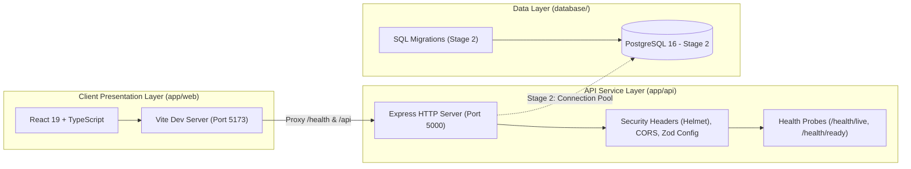

# TaskFlow implementation architecture

This folder describes the system boundaries, runtime architecture, and request/data flows of the TaskFlow application.

---

## Architecture Decision Records (ADRs)

- [0001 — Project folder structure](../decisions/0001-project-folder-structure.md): Accepted layout establishing `app/` (web, api, shared), `database/`, `infrastructure/`, and root concerns.
- [0002 — Stage 1 application foundation](../decisions/0002-stage-1-application-foundation.md): Accepted tooling establishing npm workspaces, Node.js (>=20), Express 4.21, React 19, Vite 6, TypeScript, Zod, and `node:test`.

---

## Implemented Architecture Guides

- **[Stage 1: Workspace and Application Foundation](01-workspace-and-application-foundation.md)**: Full explanation of the monorepo workspace setup, Express security middleware, Zod configuration validation, `/health/live` and `/health/ready` probe design, React 19 client dashboard, Vite development proxy, and automated testing verification.

---

## System Boundaries and Responsibilities

### 1. Web Client (`app/web/`)
- Pure client-side browser application bundled using Vite.
- Responsible for presentation, accessible UI, and dispatching asynchronous HTTP requests.
- Never trusted as an authority on authorization, business rules, or data validation.

### 2. Backend API (`app/api/`)
- Single authoritative boundary for application business logic, validation, and data security.
- Enforces strict environment typing (`Zod`), security headers (`Helmet`), and explicit CORS origin checks.
- Exposes modular routes beginning with `/health` and expanding to `/api/auth` and `/api/tasks`.

### 3. Data Layer (`database/`)
- Dedicated to schema definitions, versioned SQL migrations, and development seed fixtures.
- Interacted with exclusively through the backend API via parameterized queries.
